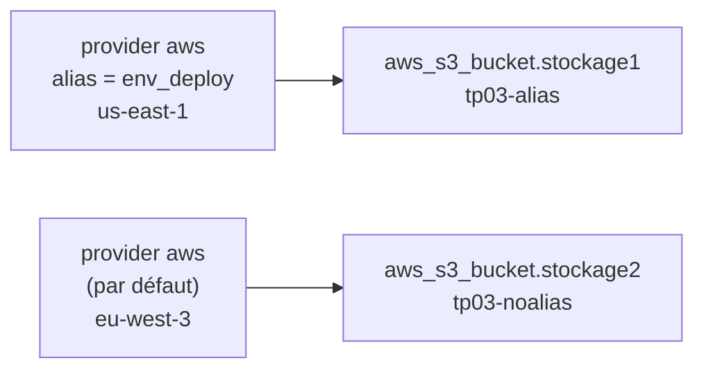

# 🌍 TP03 — Plusieurs configurations de provider et alias (multi-régions)


> 👤 **Réalisé par Mouhamadou Moustapha THIAM** — Ingénieur DevOps / DevSecOps

---

## 📌 Objectif

Déployer des ressources dans **deux régions AWS différentes** depuis **un seul projet Terraform**, grâce aux **alias de provider**.

**Scénario :** un bucket S3 aux États-Unis (`us-east-1`) et un second en Europe (`eu-west-3`, Paris), gérés dans la même configuration.

### Objectifs de l'examen couverts

| Code | Objectif |
|------|----------|
| 1c | Expliquer comment Terraform gère les workflows multi-cloud, hybrides et multi-régions |
| 2b | Décrire comment Terraform utilise les providers |
| 2c | Écrire une configuration Terraform utilisant plusieurs providers |

---

## 🏗️ Ressources déployées

| Adresse Terraform | Nom du bucket | Configuration de provider | Région |
|-------------------|---------------|---------------------------|--------|
| `aws_s3_bucket.stockage1` | `tp03-alias` | `aws.env_deploy` (alias) | `us-east-1` |
| `aws_s3_bucket.stockage2` | `tp03-noalias` | `aws` (par défaut) | `eu-west-3` |



---

## 📁 Structure du projet

```text
tp03-alias/
├── versions.tf           # Contraintes de version de Terraform et du provider AWS
├── main.tf               # Deux configurations du provider AWS et deux buckets
├── .terraform.lock.hcl   # Version exacte du provider (versionné)
└── README.md
```

---

## 🧩 Code

### `main.tf`

```hcl
# Environnement de déploiement des comptes de stockage (Virginie du Nord)
provider "aws" {
  region = "us-east-1"
  alias  = "env_deploy"
}

# Configuration par défaut (Paris)
provider "aws" {
  region = "eu-west-3"
}

resource "aws_s3_bucket" "stockage1" {
  bucket   = "tp03-alias"
  provider = aws.env_deploy
}

resource "aws_s3_bucket" "stockage2" {
  bucket = "tp03-noalias"
}
```

---

## 🔬 Déroulé et observations

### 1. Deux providers « aws » sans alias → erreur

Première tentative : deux blocs `provider "aws"` écrits l'un sous l'autre.

```text
Error: Duplicate provider configuration

A default (non-aliased) provider configuration for "aws" was already given at main.tf:1,1-15.
If multiple configurations are required, set the "alias" argument for alternative configurations.
```

Ce n'est **pas** un problème d'installation, mais de **configuration** : il ne peut exister **qu'une seule configuration par défaut** par provider. Sinon, Terraform ne saurait pas laquelle utiliser pour une ressource.

### 2. Ajout d'un alias

- Le bloc **sans alias** devient la configuration **par défaut**.
- Le bloc **avec alias** est une configuration **alternative**, qu'il faut demander explicitement.

### 3. Choisir la configuration d'une ressource

Le méta-argument `provider` désigne la configuration à utiliser :

```hcl
provider = aws.env_deploy   # <nom_du_provider>.<alias>, SANS guillemets
```

| Ressource | Argument `provider` | Configuration utilisée |
|-----------|---------------------|------------------------|
| `stockage1` | `aws.env_deploy` | alias → `us-east-1` |
| `stockage2` | *(aucun)* | défaut → `eu-west-3` |

### 4. Un provider installé, deux configurations

`terraform init` n'a téléchargé **qu'un seul plugin AWS**. L'alias ne télécharge rien : il crée une **deuxième configuration** du même plugin.

### 5. Vérification côté AWS

```bash
aws s3api get-bucket-location --bucket tp03-alias
```

```json
{
    "LocationConstraint": null
}
```

`null` signifie **`us-east-1`** : c'est la région historique de S3 (lancé en 2006), que l'API traite comme région par défaut. Pour les autres régions, la valeur réelle est renvoyée (ici `"eu-west-3"`).

---

## 📖 Ce que j'ai appris

- **Une seule configuration par défaut** par provider ; les autres doivent avoir un `alias`.
- Une ressource **sans** argument `provider` utilise la configuration **par défaut**.
- La référence `aws.env_deploy` s'écrit **sans guillemets** : c'est une référence, pas une chaîne.
- **Un provider installé ≠ une configuration** : l'alias ne télécharge rien de plus.
- Pour un **module**, on transmet une configuration avec la map `providers` :

```hcl
module "sauvegarde" {
  source = "./modules/bucket"
  providers = {
    aws = aws.env_deploy
  }
}
```

| Où | Syntaxe |
|----|---------|
| Ressource | `provider = aws.alias` (singulier) |
| Module | `providers = { aws = aws.alias }` (pluriel, map) |

- Les alias servent aussi pour **plusieurs comptes AWS** (rôles différents), pas seulement plusieurs régions.

---

## 🐛 Difficultés rencontrées et solutions

### Nom de bucket invalide

**Problème :** `bucket = "tp03-alias-"` (tiret final).
**Règle S3 :** un nom de bucket doit **commencer et se terminer par une lettre ou un chiffre**. `terraform validate` ne le détecte pas (il ne contacte pas AWS) : c'est l'`apply` qui échoue.
**Solution :** `tp03-alias`.

### Région AWS CLI invalide (encore)

**Problème :** `Could not connect to the endpoint URL: "https://s3.yes.amazonaws.com/..."`
**Cause :** région `yes` saisie lors de `aws configure`. Terraform n'était pas affecté (la région est dans le bloc `provider`), mais l'AWS CLI si.
**Solution :** `aws configure set region us-east-1`.

### Nom local Terraform vs nom AWS

**Problème :** `aws s3api get-bucket-location --bucket stockage1` a échoué.
**Cause :** `stockage1` est le **nom local Terraform** ; AWS ne connaît que le nom du bucket (`tp03-alias`).
**Réflexe :** se demander « est-ce que je parle à **Terraform** ou à **AWS** ? ». En cas de doute :

```bash
terraform state show aws_s3_bucket.stockage1   # ligne bucket = "..."
```

---

## ✅ Résultat

- [x] Deux configurations du provider AWS (défaut + alias)
- [x] Deux buckets déployés dans deux régions depuis un seul projet
- [x] Régions vérifiées avec l'AWS CLI
- [x] Un seul plugin installé pour deux configurations
- [x] Infrastructure détruite : coût AWS nul

---

## 📚 Ressources

- [Exam Content List — Terraform Associate 004](https://developer.hashicorp.com/terraform/tutorials/certification-004/associate-review-004)
- [Provider Configuration — alias](https://developer.hashicorp.com/terraform/language/providers/configuration#alias-multiple-provider-configurations)
- [Providers within Modules](https://developer.hashicorp.com/terraform/language/modules/develop/providers)
- [Règles de nommage des buckets S3](https://docs.aws.amazon.com/AmazonS3/latest/userguide/bucketnamingrules.html)

---

## 👤 Auteur

**Mouhamadou Moustapha THIAM**
Ingénieur DevOps / DevSecOps

[](https://github.com/mouhamoustaphathiam-cmd)

*Infrastructure as Code · Cloud AWS · CI/CD · Sécurité*

---
