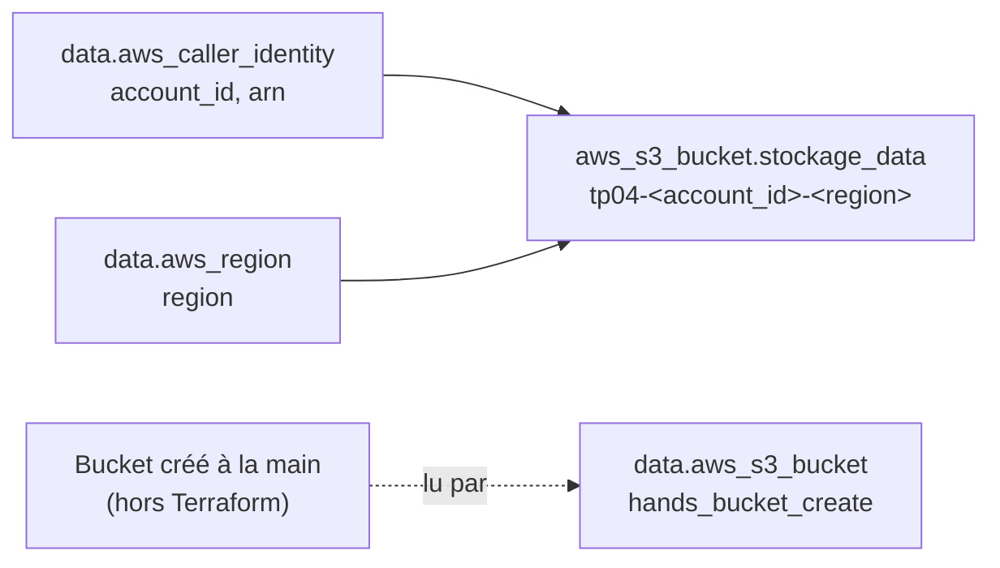

# 🔍 TP04 — Blocs `resource` vs `data` et références entre ressources


> 👤 **Réalisé par Mouhamadou Moustapha THIAM** — Ingénieur DevOps / DevSecOps

---

## 📌 Objectif

Comprendre la différence entre **créer** et **lire** de l'infrastructure avec Terraform :

- lire des informations existantes avec des **data sources** (compte AWS, région, bucket) ;
- explorer les valeurs avec **`terraform console`** ;
- construire une ressource à partir de ces informations (**références**) ;
- prouver que **`terraform destroy` ne supprime que ce que Terraform gère**.

### Objectifs de l'examen couverts

| Code | Objectif |
|------|----------|
| 4a | Utiliser et différencier les blocs `resource` et `data` |
| 4b | Référencer des attributs et créer des références entre ressources |
| 3d | Générer et analyser un plan d'exécution |
| 6b | Décrire le verrouillage du state (*observé en pratique*) |

---

## ⚖️ `resource` vs `data`

| | `resource` (managed resource) | `data` (data resource) |
|---|---|---|
| Rôle | **Créer et gérer** un objet | **Lire** un objet existant |
| Adresse | `<TYPE>.<NOM>` | **`data.`**`<TYPE>.<NOM>` |
| Lu ou créé… | créé à l'**apply** | lu au **plan** |
| Au `destroy` | ❌ supprimé | ✅ jamais touché |
| Objet absent dans le cloud | recréé au prochain apply | le plan **échoue** |

---

## 🏗️ Blocs utilisés

| Adresse Terraform | Type de bloc | Rôle |
|-------------------|--------------|------|
| `data.aws_caller_identity.aws_id` | data | Lit l'identité AWS courante (compte, ARN) |
| `data.aws_region.region_aws` | data | Lit la région du provider |
| `data.aws_s3_bucket.hands_bucket_create` | data | Lit un bucket créé **à la main** |
| `aws_s3_bucket.stockage_data` | resource | Bucket nommé à partir des data sources |



---

## 🧩 Code

### `main.tf`

```hcl
provider "aws" {
  region = "us-east-1"
}

# Lecture d'informations existantes (aucune création)
data "aws_region" "region_aws" {}

data "aws_caller_identity" "aws_id" {}

# Ressource construite à partir des data sources
resource "aws_s3_bucket" "stockage_data" {
  bucket = "tp04-${data.aws_caller_identity.aws_id.account_id}-${data.aws_region.region_aws.region}"

  tags = {
    Name   = "tp04-data"
    Region = data.aws_region.region_aws.region
    Owner  = data.aws_caller_identity.aws_id.arn
  }
}

# Lecture d'un bucket créé manuellement dans la console AWS
data "aws_s3_bucket" "hands_bucket_create" {
  bucket = "tp04-datasources"
}
```

---

## 🔬 Déroulé et observations

### 1. Des data sources seules : rien n'est créé

```text
Apply complete! Resources: 0 added, 0 changed, 0 destroyed.
```

```bash
terraform state list
# data.aws_caller_identity.aws_id
# data.aws_region.region_aws
```

Les data sources sont pourtant **enregistrées dans le state**, avec le préfixe **`data.`**.

### 2. Explorer avec `terraform console`

```text
> data.aws_region.region_aws
{
  "description" = "US East (N. Virginia)"
  "endpoint"    = "ec2.us-east-1.amazonaws.com"
  "id"          = "us-east-1"
  "name"        = "us-east-1"
  "region"      = "us-east-1"
}

> data.aws_region.region_aws.region
"us-east-1"

> data.aws_caller_identity.aws_id.account_id
"<ACCOUNT_ID>"
```

Construction d'une adresse :

| Morceau | Valeur |
|---------|--------|
| Préfixe (bloc `data`) | `data` |
| Type | `aws_caller_identity` |
| Nom local | `aws_id` |
| Attribut | `account_id` |

➡️ `data.aws_caller_identity.aws_id.account_id`

ℹ️ Depuis le provider AWS 6.x, l'attribut `name` de `aws_region` est **déprécié** au profit de `region`.

### 3. Une ressource alimentée par des data sources

```text
+ bucket = "tp04-<ACCOUNT_ID>-us-east-1"
+ tags   = {
    + "Name"   = "tp04-data"
    + "Owner"  = "arn:aws:iam::<ACCOUNT_ID>:..."
    + "Region" = "us-east-1"
  }

Plan: 1 to add, 0 to change, 0 to destroy.
```

Le nom est **connu dès le plan**, contrairement au TP02 :

| | Valeur obtenue… | Dans le plan |
|---|---|---|
| `random_pet` (resource, TP02) | **générée** à l'apply | `(known after apply)` |
| `aws_caller_identity` (data) | **lue** au plan | valeur réelle |

Ordre déduit par le **graphe de dépendances** : les data sources sont lues d'abord, car le bucket les référence (dépendances implicites).

### 4. Lire un bucket créé hors de Terraform

```text
data.aws_s3_bucket.hands_bucket_create: Reading...
data.aws_caller_identity.aws_id: Reading...
data.aws_region.region_aws: Reading...
aws_s3_bucket.stockage_data: Refreshing state... [id=tp04-<ACCOUNT_ID>-us-east-1]
data.aws_s3_bucket.hands_bucket_create: Read complete after 0s [id=tp04-datasources]

No changes. Your infrastructure matches the configuration.
```

- `Reading...` → une **data source** est lue ;
- `Refreshing state...` → une **ressource gérée** est rafraîchie depuis AWS.

### 5. La preuve par le `destroy`

```bash
terraform destroy
```

| Bucket | Type de bloc | Après le destroy |
|--------|--------------|------------------|
| `tp04-<ACCOUNT_ID>-us-east-1` | `resource` | ❌ supprimé |
| `tp04-datasources` | `data` | ✅ toujours présent dans AWS |

Le plan de destruction n'annonçait **qu'une seule ressource**. **Terraform ne détruit que ce qu'il gère.**

---

## 📖 Ce que j'ai appris

- Une data source est **en lecture seule** : elle ne crée, ne modifie et ne détruit jamais rien.
- Son adresse commence toujours par **`data.`** ; sans ce préfixe, Terraform cherche une ressource gérée.
- Les data sources sont lues pendant le **plan** (pas pendant `init`, qui ne contacte jamais le cloud). Exception : si elles dépendent d'une valeur inconnue, la lecture est reportée à l'apply.
- Vocabulaire officiel : **managed resource** (`resource`) vs **data resource** (`data`).
- `terraform console` permet de tester des expressions à partir du **state**.
- Dans une map HCL, `=` et `:` sont acceptés, mais la convention est **`=`**.
- Pour les data sources « courantes », le nom local conventionnel est **`current`** (`data.aws_region.current`).

---

## 🐛 Difficultés rencontrées et solutions

### Adresse incomplète dans la console

**Problème :** `account_id` et `aws_caller_identity.aws_id` renvoyaient `Invalid reference` / `Reference to undeclared resource`.
**Cause :** un attribut seul ne désigne aucun objet, et sans le préfixe `data.`, Terraform cherche une ressource gérée.
**Solution :** Terraform le suggérait lui-même : `Did you mean the data resource data.aws_caller_identity.aws_id?`

### Mauvaise data source pour la région

**Problème :** `aws_account_regions` puis `aws_regions` ne renvoyaient pas la région courante.
**Cause :** ces data sources **listent** les régions disponibles.
**Solution :** `aws_region`, au **singulier**, qui lit la région configurée dans le provider.

### State verrouillé pendant la console

**Problème :** VS Code ne pouvait pas ouvrir `terraform.tfstate`, et un fichier `.terraform.tfstate.lock.info` était apparu.
**Cause :** `terraform console` **verrouille le state** tant qu'elle est ouverte, pour empêcher toute opération concurrente.
**Solution :** `exit` dans la console. Pour lire le state, utiliser `terraform show` ou `terraform state show` plutôt que le fichier JSON. Ajout de `.terraform.tfstate.lock.info` au `.gitignore`.
**À retenir :** un verrou bloqué après un plantage se libère avec `terraform force-unlock <LOCK_ID>`, uniquement si aucune opération n'est en cours.

### `resource` au lieu de `data`

**Problème :** `Error: creating S3 Bucket (tp04-datasources): BucketAlreadyExists`
**Cause :** le bucket manuel était déclaré avec un bloc **`resource`** : Terraform tentait de le **créer** au lieu de le lire.
**Solution :** remplacer `resource` par **`data`**.

---

## ✅ Résultat

- [x] Data sources `aws_caller_identity`, `aws_region` et `aws_s3_bucket` lues
- [x] Adresses construites et testées dans `terraform console`
- [x] Bucket nommé dynamiquement à partir des data sources
- [x] Preuve que `destroy` ne supprime pas un objet lu par une data source
- [x] Verrouillage du state observé et compris
- [x] Bucket manuel supprimé à la main, infrastructure détruite : coût AWS nul

---

## 📚 Ressources

- [Exam Content List — Terraform Associate 004](https://developer.hashicorp.com/terraform/tutorials/certification-004/associate-review-004)
- [Data Sources](https://developer.hashicorp.com/terraform/language/data-sources)
- [References to Named Values](https://developer.hashicorp.com/terraform/language/expressions/references)
- [Command: console](https://developer.hashicorp.com/terraform/cli/commands/console)
- [State Locking](https://developer.hashicorp.com/terraform/language/state/locking)

---

## 👤 Auteur

**Mouhamadou Moustapha THIAM**
Ingénieur DevOps / DevSecOps

[](https://github.com/mouhamoustaphathiam-cmd)

*Infrastructure as Code · Cloud AWS · CI/CD · Sécurité*

---

