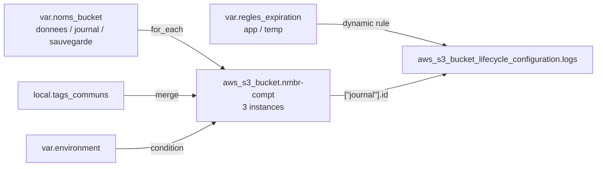

# TP06 — Expressions, fonctions, `count`, `for_each` et blocs `dynamic`


> **Réalisé par Mouhamadou Moustapha THIAM** — Ingénieur DevOps / DevSecOps

---

## Objectif

Écrire une configuration **dynamique** : créer plusieurs ressources à partir d'un seul bloc, calculer des valeurs et générer des blocs imbriqués.

- créer plusieurs buckets avec **`count`**, puis comprendre son **piège** ;
- corriger ce piège avec **`for_each`** ;
- utiliser des **fonctions** (`length`, `toset`, `merge`) et des **`locals`** ;
- écrire une **expression conditionnelle** et une **expression `for`** ;
- générer des blocs répétés avec **`dynamic`**.

**Scénario :** l'équipe a besoin de trois buckets (`data`, `logs`, `backup`), avec des tags communs, une protection des données hors dev, et des règles de suppression automatique sur le bucket de logs.

### Objectifs de l'examen couverts

| Code | Objectif |
|------|----------|
| 4e | Écrire une configuration dynamique avec des expressions et des fonctions |
| 4c | Utiliser les variables et les outputs |
| 4d | Utiliser les types complexes |
| 4f | Dépendances implicites entre ressources |

---

## Ressources déployées

| Adresse Terraform | Nom du bucket | Rôle |
|-------------------|---------------|------|
| `aws_s3_bucket.nmbr-compt["donnees"]` | `tp06-mmt-bucket-data` | Données |
| `aws_s3_bucket.nmbr-compt["journal"]` | `tp06-mmt-bucket-logs` | Journaux |
| `aws_s3_bucket.nmbr-compt["sauvegarde"]` | `tp06-mmt-bucket-backup` | Sauvegardes |
| `aws_s3_bucket_lifecycle_configuration.logs` | *(sur le bucket logs)* | Expiration automatique des fichiers |



---

## Structure du projet

```text
tp06-expressions/
├── versions.tf
├── variables.tf      # Région, noms des buckets, environnement, règles d'expiration
├── main.tf           # locals, buckets, configuration de cycle de vie
├── outputs.tf        # Map nom → ARN
├── .terraform.lock.hcl
└── README.md
```

---

## Code

### `variables.tf`

```hcl
variable "region_aws" {
  description = "AWS region"
  type        = string
  default     = "us-east-1"
}

variable "noms_bucket" {
  description = "Nom des compartiments (cle = identite Terraform, valeur = nom AWS)"
  type        = map(string)
  default = {
    donnees    = "data"
    journal    = "logs"
    sauvegarde = "backup"
  }
}

variable "environment" {
  description = "Environnement de deploiement"
  type        = string
  default     = "dev"
}

variable "regles_expiration" {
  description = "Nombre de jours avant suppression, par dossier"
  type        = map(number)
  default = {
    app  = 30
    temp = 7
  }
}
```

### `main.tf`

```hcl
provider "aws" {
  region = var.region_aws
}

locals {
  tags_communs = {
    Project = "tp06"
    Owner   = "mmt"
  }
}

resource "aws_s3_bucket" "nmbr-compt" {
  for_each = var.noms_bucket

  bucket        = "tp06-mmt-bucket-${each.value}"
  force_destroy = var.environment == "dev"
  tags          = merge(local.tags_communs, { Name = each.value })
}

resource "aws_s3_bucket_lifecycle_configuration" "logs" {
  bucket = aws_s3_bucket.nmbr-compt["journal"].id

  dynamic "rule" {
    for_each = var.regles_expiration

    content {
      id     = rule.key
      status = "Enabled"

      filter {
        prefix = "${rule.key}/"
      }

      expiration {
        days = rule.value
      }
    }
  }
}
```

### `outputs.tf`

```hcl
output "bucket_arn" {
  description = "ARN de chaque compartiment, par cle"
  value       = { for key, bucket in aws_s3_bucket.nmbr-compt : key => bucket.arn }
}
```

---

## Déroulé et observations

### 1. Plusieurs instances avec `count`

```hcl
resource "aws_s3_bucket" "nmbr-compt" {
  count  = var.noms_bucket            # un nombre, ici 3
  bucket = "tp06-mmt-bucket-${count.index}"
}
```

Adresses obtenues : `aws_s3_bucket.nmbr-compt[0]`, `[1]`, `[2]`.

- `count.index` commence à **0**, comme les index de liste ;
- un seul élément : `aws_s3_bucket.nmbr-compt[1].arn` ;
- tous les éléments (expression **splat**) : `aws_s3_bucket.nmbr-compt[*].arn`.

### 2. `count` piloté par une liste et la fonction `length`

```hcl
count  = length(var.noms_bucket)                          # ["logs", "data", "backup"] → 3
bucket = "tp06-mmt-bucket-${var.noms_bucket[count.index]}"
```

Les crochets **prennent un élément** (`var.noms_bucket[0]` → `"logs"`) ; pour **compter**, il faut la fonction `length()`.

### 3. Le piège de `count` : retirer un élément du milieu

Retrait de `"data"` → la liste devient `["logs", "backup"]` :

| Adresse | Avant | Après | Action prévue |
|---|---|---|---|
| `[0]` | `logs` | `logs` | aucune |
| `[1]` | `data` | `backup` | **remplacement** `-/+` |
| `[2]` | `backup` | *n'existe plus* | **destruction** `-` |

```text
Plan: 1 to add, 0 to change, 2 to destroy.
```

Avec `count`, Terraform identifie les instances par leur **position**. `backup` glisse de `[2]` à `[1]` : le vrai bucket de sauvegarde serait **détruit** puis recréé **vide**.

### 4. La solution : `for_each`

```hcl
for_each = var.noms_bucket            # map ou set, jamais une liste
bucket   = "tp06-mmt-bucket-${each.value}"
```

Adresses obtenues : `aws_s3_bucket.nmbr-compt["donnees"]`, `["journal"]`, `["sauvegarde"]`.

Retrait de `donnees` :

```text
Plan: 0 to add, 0 to change, 1 to destroy.
```

Seule l'instance retirée est touchée : les autres gardent **leur clé**.

| Instance | `each.key` | `each.value` |
|---|---|---|
| `["donnees"]` | `donnees` | `data` |
| `["journal"]` | `journal` | `logs` |
| `["sauvegarde"]` | `sauvegarde` | `backup` |

La **clé** est l'identité de l'instance dans le state ; la **valeur** est une donnée associée.

**Pourquoi `for_each` refuse une liste :** chaque élément devient une clé d'adresse. Une liste `["logs", "logs"]` produirait deux instances à la même adresse. Seuls un **set** (doublons éliminés, `toset()`) ou une **map** (clés uniques) le garantissent.

### 5. `locals` et fonction `merge`

```hcl
tags = merge(local.tags_communs, { Name = each.value })
```

```text
+ tags = {
    + "Name"    = "backup"
    + "Owner"   = "mmt"
    + "Project" = "tp06"
  }
```

En cas de clé en double, **la dernière map l'emporte**.

### 6. Expression conditionnelle

```hcl
force_destroy = var.environment == "dev" ? true : false
# forme simplifiée, la comparaison renvoyant déjà un booléen :
force_destroy = var.environment == "dev"
```

| Commande | `force_destroy` |
|---|---|
| `terraform plan` | `true` |
| `terraform plan -var="environment=prod"` | `false` |

En dev, les buckets peuvent être détruits même pleins ; en prod, Terraform refuse de détruire un bucket qui contient des données.

### 7. Expression `for` dans un output

```text
bucket_arn = {
  "donnees"    = "arn:aws:s3:::tp06-mmt-bucket-data"
  "journal"    = "arn:aws:s3:::tp06-mmt-bucket-logs"
  "sauvegarde" = "arn:aws:s3:::tp06-mmt-bucket-backup"
}
```

| Syntaxe | Résultat |
|---|---|
| `{ for k, v in X : k => v.arn }` | une **map** |
| `[ for k, v in X : v.arn ]` | une **liste** |

### 8. Bloc `dynamic`

Un bloc `rule` est généré pour chaque élément de `var.regles_expiration` :

| Élément | `rule.key` | `rule.value` | Règle générée |
|---|---|---|---|
| `app = 30` | `app` | `30` | dossier `app/`, suppression après 30 jours |
| `temp = 7` | `temp` | `7` | dossier `temp/`, suppression après 7 jours |

Ajouter `archives = 365` dans la variable produit une **troisième règle sans modifier la ressource**.

Dans un `dynamic`, l'itérateur porte **le nom du bloc** (`rule.key`, `rule.value`), et non `each`.

---

## Ce que j'ai appris

| Mécanisme | Répète | Identifie par | Objet d'itération |
|---|---|---|---|
| `count` | des ressources | la **position** | `count.index` |
| `for_each` | des ressources | la **clé** | `each.key`, `each.value` |
| `dynamic` | des blocs imbriqués | la clé | `<nom_du_bloc>.key`, `.value` |

- `count` pour des copies **identiques et interchangeables** ; `for_each` pour des objets ayant une **identité** propre.
- Le bloc s'écrit **`locals`**, la référence **`local.x`**.
- Une **variable** est fournie par l'utilisateur (modifiable avec `-var`) ; un **local** est calculé par le code (non modifiable de l'extérieur).
- `terraform state show` attend une **instance**, pas un attribut. Sous PowerShell, entourer l'adresse de guillemets simples : `terraform state show 'aws_s3_bucket.nmbr-compt[0]'`.
- Référencer une ressource plutôt qu'écrire son nom en dur crée une **dépendance implicite**.
- Éviter l'abus de `dynamic` : il nuit à la lisibilité quand le nombre de blocs est fixe.

---

## Difficultés rencontrées et solutions

### Index au lieu de fonction

**Problème :** `count = var.noms_bucket[3]`.
**Cause :** les crochets prennent un élément (ici inexistant : `Invalid index`) et renvoient une chaîne, alors que `count` attend un nombre.
**Solution :** `count = length(var.noms_bucket)`.

### Attribut passé à `terraform state show`

**Problème :** `Error parsing instance address: aws_s3_bucket.nmbr-compt[0].id`.
**Cause :** la commande attend l'adresse d'une instance, pas d'un attribut.
**Solution :** `terraform state show 'aws_s3_bucket.nmbr-compt[0]'`, ou `terraform console` pour un attribut seul.

### `locals.` au lieu de `local.`, et `validation` détourné

**Problème :** `${locals.Project}` dans les tags, et un bloc `validation` contenant `force_destroy` dans la variable `environment`.
**Causes :** la référence s'écrit au singulier ; `validation` sert à **refuser** une valeur d'entrée (TP08), et `force_destroy` est un argument du bucket.
**Solution :** `merge(local.tags_communs, {...})` et `force_destroy = var.environment == "dev"` dans la ressource.

### Exemple recopié dans l'expression `for`

**Problème :** `{ for key, value in var.noms_bucket : key => value * 2 }`.
**Cause :** reprise du contenu de l'exemple ; on parcourait la variable (sans ARN) et on multipliait une chaîne.
**Solution :** parcourir la **ressource** et prendre l'attribut : `{ for key, bucket in aws_s3_bucket.nmbr-compt : key => bucket.arn }`.

### Arguments inversés dans le `dynamic`

**Problème :** nom du bucket écrit en dur dans `bucket`, et référence au bucket (avec `var.`) dans `for_each`.
**Solution :** `bucket = aws_s3_bucket.nmbr-compt["journal"].id` (dépendance implicite) et `for_each = var.regles_expiration`.

### Idée reçue corrigée

- Faux : « `force_destroy = true` en dev protège l'environnement » → Vrai : il autorise au contraire la destruction des buckets **même pleins** ; c'est `false` qui protège les données.

---

## Résultat

- [x] Plusieurs buckets créés avec `count`, puis avec `for_each`
- [x] Piège du décalage de `count` reproduit et expliqué
- [x] Fonctions `length`, `toset` et `merge` utilisées
- [x] Tags communs centralisés dans un `local`
- [x] `force_destroy` conditionné par l'environnement
- [x] Output construit avec une expression `for`
- [x] Règles de cycle de vie générées avec `dynamic`
- [x] Infrastructure détruite : coût AWS nul

---

## Ressources

- [Exam Content List — Terraform Associate 004](https://developer.hashicorp.com/terraform/tutorials/certification-004/associate-review-004)
- [The count Meta-Argument](https://developer.hashicorp.com/terraform/language/meta-arguments/count)
- [The for_each Meta-Argument](https://developer.hashicorp.com/terraform/language/meta-arguments/for_each)
- [Local Values](https://developer.hashicorp.com/terraform/language/values/locals)
- [Conditional Expressions](https://developer.hashicorp.com/terraform/language/expressions/conditionals)
- [for Expressions](https://developer.hashicorp.com/terraform/language/expressions/for)
- [dynamic Blocks](https://developer.hashicorp.com/terraform/language/expressions/dynamic-blocks)
- [Built-in Functions](https://developer.hashicorp.com/terraform/language/functions)

---

## Auteur

**Mouhamadou Moustapha THIAM**
Ingénieur DevOps / DevSecOps

[](https://github.com/mouhamoustaphathiam-cmd)

*Infrastructure as Code · Cloud AWS · CI/CD · Sécurité*

---

Précédent : [TP05 — Variables et outputs](../tp05-variables-outputs/README.md) · [Sommaire](../README.md) · Suivant : TP07 — Dépendances et `lifecycle`