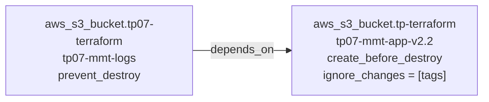

# TP07 — Dépendances explicites et bloc `lifecycle`


> **Réalisé par Mouhamadou Moustapha THIAM** — Ingénieur DevOps / DevSecOps

---

## Objectif

Contrôler **l'ordre** et le **comportement** de Terraform lors de la création, du remplacement et de la destruction des ressources :

- déclarer une **dépendance explicite** avec `depends_on` ;
- éviter une coupure lors d'un remplacement avec `create_before_destroy` ;
- protéger une ressource critique avec `prevent_destroy` ;
- tolérer des modifications manuelles avec `ignore_changes`.

**Scénario :** deux buckets, `app` et `logs`. Le bucket `logs` contient des journaux d'audit obligatoires qui ne doivent jamais être supprimés par erreur.

### Objectifs de l'examen couverts

| Code | Objectif |
|------|----------|
| 4f | Définir les dépendances entre ressources |
| 3d | Générer et analyser un plan d'exécution |
| 6d | Gérer les écarts (drift) entre le code et l'infrastructure réelle |

---

## Ressources déployées

| Adresse Terraform | Nom du bucket | Règles appliquées |
|-------------------|---------------|-------------------|
| `aws_s3_bucket.tp07-terraform` | `tp07-mmt-logs` | `prevent_destroy` |
| `aws_s3_bucket.tp-terraform` | `tp07-mmt-app-v2.2` | `depends_on`, `create_before_destroy`, `ignore_changes` |



---

## Structure du projet

```text
tp07-lifecycle/
├── versions.tf
├── main.tf
├── .terraform.lock.hcl
└── README.md
```

---

## Code

### `main.tf`

```hcl
provider "aws" {
  region = "us-east-1"
}

# Journaux d'audit : ne doivent jamais être détruits par erreur
resource "aws_s3_bucket" "tp07-terraform" {
  bucket = "tp07-mmt-logs"

  lifecycle {
    prevent_destroy = true
  }
}

# Bucket applicatif : créé après les logs, remplacé sans coupure
resource "aws_s3_bucket" "tp-terraform" {
  bucket = "tp07-mmt-app-v2.2"

  depends_on = [aws_s3_bucket.tp07-terraform]

  lifecycle {
    create_before_destroy = true
    ignore_changes        = [tags]
  }
}
```

---

## Déroulé et observations

### 1. Ressources indépendantes : création en parallèle

Sans référence entre les deux buckets, Terraform les crée **en parallèle** (jusqu'à 10 opérations simultanées par défaut). L'ordre des lignes `Creating...` peut varier d'une exécution à l'autre.

### 2. Dépendance explicite avec `depends_on`

```hcl
depends_on = [aws_s3_bucket.tp07-terraform]
```

| Opération | Ordre |
|-----------|-------|
| Création | `logs` **puis** `app` |
| Destruction | `app` **puis** `logs` (ordre inverse du graphe) |

`depends_on` ne s'utilise que pour une dépendance **cachée**, invisible dans le code (par exemple, une application qui a besoin d'une politique IAM sans la référencer). Sinon, une **référence** est préférable : elle crée la dépendance **et** transmet une valeur.

Syntaxe : une **liste d'adresses**, sans attribut (`[aws_s3_bucket.x]`, et non `aws_s3_bucket.x.id`).

### 3. Remplacement : `-/+` contre `+/-`

Changement du nom du bucket `app` (attribut immuable) :

| | Sans `lifecycle` | Avec `create_before_destroy = true` |
|---|---|---|
| Symbole | `-/+` destroy and then create replacement | `+/-` create replacement and then destroy |
| Ordre | destruction, coupure, création | création, puis destruction |

```text
aws_s3_bucket.tp-terraform: Creating...
aws_s3_bucket.tp-terraform: Creation complete after 5s [id=tp07-mmt-app-v2.2]
aws_s3_bucket.tp-terraform (deposed object 48fd4887): Destroying... [id=tp07-mmt-app-v2]
aws_s3_bucket.tp-terraform: Destruction complete after 1s
```

Le **deposed object** est l'ancienne instance, conservée temporairement dans le state jusqu'à sa destruction.

**Limite :** si le remplacement ne change pas le nom, `create_before_destroy` échoue (`BucketAlreadyOwnedByYou`), car deux buckets ne peuvent pas porter le même nom. On l'associe souvent à un nom généré (`bucket_prefix`, `random_id`).

### 4. Protection avec `prevent_destroy`

```text
Plan: 0 to add, 0 to change, 2 to destroy.

Error: Instance cannot be destroyed

Resource aws_s3_bucket.tp07-terraform has lifecycle.prevent_destroy set, but the plan calls
for this resource to be destroyed. To avoid this error and continue with the plan, either
disable lifecycle.prevent_destroy or reduce the scope of the plan using the -target option.
```

- La vérification a lieu **au plan** : **tout** le plan est annulé, le bucket `app` n'est pas détruit non plus.
- Un **remplacement** est bloqué de la même façon, puisqu'il contient une destruction.
- Sortie de secours : `terraform destroy -target='aws_s3_bucket.tp-terraform'`.

| | `force_destroy` (TP05) | `prevent_destroy` |
|---|---|---|
| Géré par | le provider AWS, propre à S3 | Terraform, pour **toute** ressource |
| Protège | les **fichiers** d'un bucket non vide | la **ressource** elle-même |
| Erreur à | l'apply | au **plan** |

**Limite :** `prevent_destroy` ne protège pas contre la **suppression du bloc `resource`** dans le code : la règle disparaît avec lui.

### 5. Modifications manuelles et `ignore_changes`

Ajout manuel du tag `Equipe = finance` dans la console AWS :

```text
~ resource "aws_s3_bucket" "tp-terraform" {
    ~ tags = {
        - "Equipe" = "finance" -> null
      }
```

Le code est la **source de vérité** : Terraform veut **retirer** le tag ajouté à la main (drift).

Avec `ignore_changes = [tags]` :

```text
No changes. Your infrastructure matches the configuration.
```

**Piège :** l'attribut est ignoré **dans les deux sens**. Un changement de `tags` dans le code n'est plus appliqué non plus ; l'attribut ne sert plus qu'à la création.

| Situation | Sans `ignore_changes` | Avec `ignore_changes = [tags]` |
|---|---|---|
| Tag ajouté dans AWS, absent du code | retiré dans AWS | conservé |
| Tag supprimé dans AWS, présent dans le code | remis dans AWS | non remis |
| Tag modifié dans le code | appliqué | **ignoré** |

---

## Ce que j'ai appris

| Argument `lifecycle` | Effet |
|---|---|
| `create_before_destroy = true` | crée le remplaçant avant de détruire l'ancien (`+/-`) |
| `prevent_destroy = true` | refuse tout plan qui détruirait la ressource |
| `ignore_changes = [attr]` | ignore les différences sur ces attributs, dans les deux sens (`all` pour tout ignorer) |
| `replace_triggered_by = [ref]` | force le remplacement quand une autre ressource ou un attribut change |

- Une dépendance implicite (référence) est toujours préférable à `depends_on`.
- La destruction suit l'ordre **inverse** des dépendances.
- Toute modification manuelle d'une ressource gérée est écrasée au prochain apply, sauf avec `ignore_changes`.

---

## Difficultés rencontrées et solutions

### Nom local modifié au lieu du nom du bucket

**Problème :** après avoir renommé le bloc en `tp07-mmt-app-v2`, le plan annonçait deux opérations séparées (`will be destroyed` / `will be created`), et `create_before_destroy` n'avait aucun effet.
**Cause :** le **nom local** forme l'adresse Terraform ; le renommer crée une nouvelle ressource. `create_before_destroy` ne s'applique qu'au **remplacement d'une même adresse**.
**Solution :** garder le nom local et modifier l'argument **`bucket`**.

### Buckets sans argument `bucket`

**Problème :** les buckets s'appelaient `terraform-360e12144ce05436479eb699e3` dans AWS.
**Cause :** sans argument `bucket`, le provider génère un nom automatiquement.
**Solution :** ajout de `bucket = "..."` dans chaque ressource.

### Point dans le nom du bucket

**Constat :** `tp07-mmt-app-v2.2` est valide, mais AWS déconseille les points dans les noms de buckets (problèmes de certificat HTTPS). Préférer les tirets : `tp07-mmt-app-v2-2`.

### Idées reçues corrigées

- Faux : « Terraform ajoute le tag créé dans la console » → Vrai : il le **retire**, car il n'est pas dans le code.
- Faux : « Avec `ignore_changes`, un changement de tags dans le code est appliqué » → Vrai : il est **ignoré** aussi.

---

## Résultat

- [x] Création parallèle observée, puis ordonnée avec `depends_on`
- [x] Remplacement sans coupure avec `create_before_destroy` (`+/-`)
- [x] Destruction bloquée par `prevent_destroy`, y compris pour les autres ressources du plan
- [x] Drift sur les tags observé, puis toléré avec `ignore_changes`
- [x] `prevent_destroy` retiré, infrastructure détruite : coût AWS nul

---

## Ressources

- [Exam Content List — Terraform Associate 004](https://developer.hashicorp.com/terraform/tutorials/certification-004/associate-review-004)
- [The depends_on Meta-Argument](https://developer.hashicorp.com/terraform/language/meta-arguments/depends_on)
- [The lifecycle Meta-Argument](https://developer.hashicorp.com/terraform/language/meta-arguments/lifecycle)
- [Resource Graph](https://developer.hashicorp.com/terraform/internals/graph)

---

## Auteur

**Mouhamadou Moustapha THIAM**
Ingénieur DevOps / DevSecOps

[](https://github.com/mouhamoustaphathiam-cmd)

*Infrastructure as Code · Cloud AWS · CI/CD · Sécurité*

---

Précédent : [TP06 — Expressions](../tp06-expressions/README.md) · [Sommaire](../README.md) · Suivant : TP08 — Validation et données sensibles