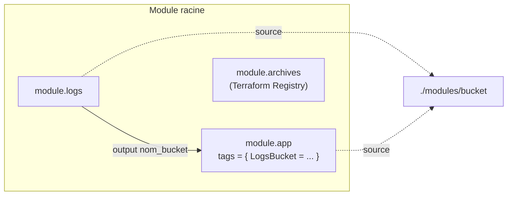

# TP10-11 — Modules : local, Terraform Registry et composition


> **Réalisé par Mouhamadou Moustapha THIAM** — Ingénieur DevOps / DevSecOps

---

## Objectif

Rendre le code **réutilisable** avec des modules :

- écrire un **module local** et l'appeler plusieurs fois ;
- comprendre la **portée des variables** et l'**encapsulation** d'un module ;
- utiliser un module du **Terraform Registry** et fixer sa **version** ;
- faire **communiquer** deux modules (composition).

Un module est un **dossier de fichiers `.tf`**, comparable à une **fonction** : il reçoit des **entrées** (variables), crée des ressources et renvoie des **sorties** (outputs).

| Terme | Définition |
|---|---|
| Module **racine** (root module) | le dossier où l'on lance `terraform` |
| Module **enfant** (child module) | un module appelé par un bloc `module` |

### Objectifs de l'examen couverts

| Code | Objectif |
|------|----------|
| 5a | Expliquer comment Terraform récupère les modules |
| 5b | Décrire la portée des variables dans les modules |
| 5c | Utiliser des modules dans une configuration |
| 5d | Gérer les versions des modules |

---

## Ressources déployées

| Module | Source | Ressources créées |
|---|---|---|
| `logs` | `./modules/bucket` (local) | 1 bucket |
| `app` | `./modules/bucket` (local) | 1 bucket, tagué avec le nom du bucket `logs` |
| `archives` | `terraform-aws-modules/s3-bucket/aws` (Registry) | bucket, versioning, blocage de l'accès public… |



---

## Structure du projet

```text
tp10-modules/
├── versions.tf
├── main.tf                  # module racine : appelle les modules
├── outputs.tf
├── .terraform.lock.hcl
├── README.md
└── modules/
    └── bucket/              # module enfant
        ├── variables.tf     # entrées : nom, env, tags
        ├── main.tf          # ressource aws_s3_bucket
        └── outputs.tf       # sorties : nom_bucket, arn
```

---

## Code

### Module enfant — `modules/bucket/variables.tf`

```hcl
variable "nom" {
  description = "Prefixe du nom du bucket"
  type        = string
}

variable "env" {
  description = "Environnement de deploiement"
  type        = string
}

variable "tags" {
  description = "Tags supplementaires"
  type        = map(string)
  default     = {}   # rend la variable optionnelle
}
```

### Module enfant — `modules/bucket/main.tf`

```hcl
resource "aws_s3_bucket" "bucket-tp-modules" {
  bucket = "${var.nom}-${var.env}"
  tags   = merge({ Environment = var.env }, var.tags)
}
```

Aucun bloc `provider` : le module hérite de celui de la racine.

### Module enfant — `modules/bucket/outputs.tf`

```hcl
output "nom_bucket" {
  description = "Nom du bucket"
  value       = aws_s3_bucket.bucket-tp-modules.bucket
}

output "arn" {
  description = "ARN du bucket"
  value       = aws_s3_bucket.bucket-tp-modules.arn
}
```

### Module racine — `main.tf`

```hcl
provider "aws" {
  region = "us-east-1"
}

module "logs" {
  source = "./modules/bucket"
  env    = "dev"
  nom    = "mmt-tp10-logs"
}

module "app" {
  source = "./modules/bucket"
  env    = "dev"
  nom    = "mmt-tp10-app"
  tags   = { LogsBucket = module.logs.nom_bucket }
}

module "archives" {
  source  = "terraform-aws-modules/s3-bucket/aws"
  version = "~> 5.17"

  bucket = "mmt-archives-hasicorp"

  versioning = {
    enabled = true
  }
}
```

### Module racine — `outputs.tf`

```hcl
output "arn_comp-app" {
  value = module.app.arn
}
```

---

## Déroulé et observations

### 1. Installation des modules

```bash
terraform init
```

- Module **local** : `init` enregistre son chemin.
- Module **Registry** : `init` le **télécharge** dans `.terraform/modules/archives/` (code consultable, à ne jamais modifier).
- Relancer `init` quand on **ajoute** un module ou qu'on change sa **`source`** ou sa **`version`** ; modifier le code d'un module local ne l'exige pas.

### 2. Adresses dans le state

```text
module.logs.aws_s3_bucket.bucket-tp-modules
module.app.aws_s3_bucket.bucket-tp-modules
module.archives.aws_s3_bucket.this[0]
```

Un même module appelé deux fois produit deux adresses distinctes, donc deux ressources distinctes. Le `[0]` révèle que le module du Registry utilise `count` en interne.

### 3. Encapsulation et portée des variables

| Depuis… | Vers… | Possible ? | Comment |
|---|---|---|---|
| la racine | une ressource **dans** un module | non | via un **output** : `module.app.arn` |
| un module | une variable de la **racine** | non | via une **variable d'entrée**, passée dans le bloc `module` |

Les **seuls** passages sont les entrées (variables) et les sorties (outputs).

### 4. Module du Terraform Registry

- Adresse : `<NAMESPACE>/<NOM>/<PROVIDER>` → `terraform-aws-modules/s3-bucket/aws`.
- **4 ressources** créées pour un seul bloc `module` : dans le provider AWS récent, chaque réglage d'un bucket (versioning, chiffrement, accès public…) est une ressource séparée, que le module assemble selon les bonnes pratiques.

| Source | Exemple | Fixer la version |
|---|---|---|
| Locale | `./modules/bucket` | impossible : c'est le code du dossier |
| Registry | `terraform-aws-modules/s3-bucket/aws` | argument **`version`** |
| Git / GitHub | `git::https://github.com/org/repo.git` | `?ref=v1.2.0` dans l'URL |

### 5. Composition : dépendance implicite entre modules

```text
module.logs.aws_s3_bucket.bucket-tp-modules: Creating...
module.archives.aws_s3_bucket.this[0]: Creating...
module.logs.aws_s3_bucket.bucket-tp-modules: Creation complete after 3s
...
module.app.aws_s3_bucket.bucket-tp-modules: Creating...

Apply complete! Resources: 5 added, 0 changed, 0 destroyed.
```

`logs` et `archives` démarrent en parallèle ; `app` attend la fin de `logs`, car il utilise `module.logs.nom_bucket`. La **référence à un output** crée une dépendance implicite : aucun `depends_on` n'est nécessaire.

---

## Ce que j'ai appris

- Un module construit ses ressources **à partir de ses entrées** ; un nom écrit en dur le rend inutilisable plusieurs fois.
- Dans un module, **toute variable sans `default` est obligatoire** pour l'appelant.
- Par convention, la ressource unique d'un module s'appelle souvent **`this`**.
- `merge(map)` avec une seule map ne fait rien ; on fusionne un tag commun **et** les tags reçus.
- L'argument `version` ne fonctionne qu'avec un **registre**.
- Préférer `~> 5.17` à `5.17.0` pour recevoir les correctifs sans risque de changement majeur.

---

## Difficultés rencontrées et solutions

### Accès direct à une ressource d'un module

**Problème :** `tags = { LogsBucket = module.logs.aws_s3_bucket.bucket-tp-modules.id }`.
**Cause :** la racine ne voit pas l'intérieur d'un module (encapsulation).
**Solution :** passer par l'output : `module.logs.nom_bucket`.

### Cycle de dépendances

**Problème :** `app` recevait le nom de `logs`, et `logs` celui de `app`, puis `logs` se référençait lui-même.
**Cause :** chaque module attendait l'autre (ou lui-même) : `Error: Cycle`.
**Solution :** seul `app` reçoit le tag ; `logs` n'a pas de `tags`.

### Variable obligatoire non fournie

**Problème :** `Required attribute "tags" not specified` sur le module `logs`.
**Cause :** la variable `tags` du module n'avait pas de valeur par défaut.
**Solution :** `default = {}` dans `modules/bucket/variables.tf`.

### Nom de bucket écrit en dur dans le module

**Problème :** `bucket = "tp-bucket-10"` : les deux appels auraient créé le même bucket, et `nom`/`env` étaient ignorés.
**Solution :** `bucket = "${var.nom}-${var.env}"`.

### Valeur d'environnement inadaptée

**Problème :** `env = "Environnement"`.
**Cause :** la majuscule rend le nom de bucket invalide pour AWS, et la variable doit contenir l'environnement lui-même.
**Solution :** `env = "dev"`.

### Clé d'input du module Registry

**Problème :** `versioning = { enable = true }`.
**Cause :** le module attend la clé `enabled` ; une clé erronée peut passer sans erreur et laisser le versioning désactivé.
**Solution :** vérifier la section **Inputs** de la documentation du module : `enabled = true`.

---

## Résultat

- [x] Module local créé et appelé deux fois
- [x] Encapsulation et portée des variables vérifiées
- [x] Module du Registry utilisé avec une contrainte de version
- [x] Composition de modules avec dépendance implicite
- [x] Infrastructure détruite : coût AWS nul

---

## Ressources

- [Exam Content List — Terraform Associate 004](https://developer.hashicorp.com/terraform/tutorials/certification-004/associate-review-004)
- [Modules Overview](https://developer.hashicorp.com/terraform/language/modules)
- [Module Sources](https://developer.hashicorp.com/terraform/language/modules/sources)
- [Module Block Reference](https://developer.hashicorp.com/terraform/language/block/module)
- [Module terraform-aws-modules/s3-bucket](https://registry.terraform.io/modules/terraform-aws-modules/s3-bucket/aws/latest)

---

## Auteur

**Mouhamadou Moustapha THIAM**
Ingénieur DevOps / DevSecOps

[](https://github.com/mouhamoustaphathiam-cmd)

*Infrastructure as Code · Cloud AWS · CI/CD · Sécurité*

---

Précédent : [TP09 — Données sensibles](../tp09-sensitive/README.md) · [Sommaire](../README.md) · Suivant : TP12 — Backend S3 et verrouillage du state