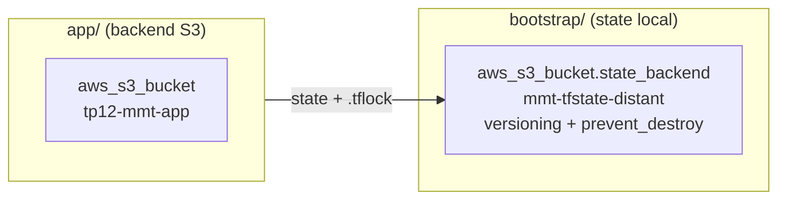

# TP12 — Backend distant S3 et verrouillage du state


> **Réalisé par Mouhamadou Moustapha THIAM** — Ingénieur DevOps / DevSecOps

---

## Objectif

Sortir le state du poste de travail pour permettre le **travail en équipe** :

- créer un bucket S3 dédié au state (versionné et protégé) ;
- **migrer** un state local vers un **backend distant** S3 ;
- comprendre pourquoi les variables sont **interdites** dans le bloc `backend` ;
- observer le **verrouillage** du state lors d'opérations concurrentes.

**Pourquoi un backend distant ?** Un state local n'est pas partagé, peut être perdu avec le disque, peut être corrompu par deux applies simultanés, et contient des secrets en clair.

### Objectifs de l'examen couverts

| Code | Objectif |
|------|----------|
| 2d | Expliquer comment Terraform utilise et gère le state |
| 6a | Décrire le backend local |
| 6b | Décrire le verrouillage du state |
| 6c | Configurer un state distant avec le bloc `backend` |

---

## Architecture



**Le paradoxe de l'œuf et de la poule :** le bucket qui stocke le state doit exister **avant** la configuration du backend. Il est donc créé par un projet séparé (`bootstrap/`), qui garde un state local.

---

## Structure du projet

```text
tp12-backend/
├── bootstrap/            # crée le bucket du state (state local)
│   ├── versions.tf
│   └── main.tf
├── app/                  # projet dont le state est stocké dans S3
│   ├── versions.tf       # contient le bloc backend "s3"
│   └── main.tf
└── README.md
```

---

## Code

### `bootstrap/main.tf`

```hcl
provider "aws" {
  region = "us-east-1"
}

resource "aws_s3_bucket" "state_backend" {
  bucket = "mmt-tfstate-distant"

  lifecycle {
    prevent_destroy = true
  }
}

resource "aws_s3_bucket_versioning" "backend_state" {
  bucket = aws_s3_bucket.state_backend.id

  versioning_configuration {
    status = "Enabled"
  }
}
```

### `app/versions.tf`

```hcl
terraform {
  required_version = ">=1.12"

  required_providers {
    aws = {
      source  = "hashicorp/aws"
      version = "~>6.0"
    }
  }

  backend "s3" {
    bucket       = "mmt-tfstate-distant"
    key          = "tp12-backend/app/tfstate"
    region       = "us-east-1"
    encrypt      = true
    use_lockfile = true
  }
}
```

### `app/main.tf`

```hcl
provider "aws" {
  region = "us-east-1"
}

resource "aws_s3_bucket" "app" {
  bucket = "tp12-mmt-app"
}
```

---

## Déroulé et observations

### 1. Protéger le bucket du state

| Réglage | Raison |
|---|---|
| **Versioning** | si un apply corrompt le state, on restaure une version précédente |
| **`prevent_destroy`** | empêche la suppression accidentelle du bucket qui contient la vérité de toute l'infrastructure |
| **Chiffrement** | le state contient des valeurs sensibles en clair (TP09) ; S3 chiffre les objets par défaut et `encrypt = true` le garantit côté backend |

### 2. Migration du state local vers S3

1. `terraform apply` avec le backend local : `terraform.tfstate` apparaît dans le dossier.
2. Ajout du bloc `backend "s3"`, puis :

```bash
terraform init
```

```text
Do you want to copy existing state to the new backend?
  Enter a value: yes
```

- Le state est copié dans S3 : `mmt-tfstate-distant/tp12-backend/app/tfstate`.
- Le fichier local `terraform.tfstate` est **vidé** : il ne sert plus.

### 3. Pas de variables dans le bloc `backend`

```hcl
backend "s3" {
  bucket = var.state_bucket   # interdit
}
```

```text
Error: Variables not allowed
```

Le backend est lu par `terraform init`, **avant** l'évaluation des variables. Solution : la **configuration partielle**.

```bash
terraform init -backend-config="bucket=mmt-tfstate-distant"
terraform init -backend-config=backend.hcl
```

Elle permet d'utiliser le même code avec un backend différent par environnement.

### 4. Verrouillage du state

Test avec deux terminaux :

| Terminal 1 | Terminal 2 |
|---|---|
| `terraform apply`, laissé en attente de confirmation | — |
| (un fichier `.tflock` apparaît dans S3) | `terraform plan` → **erreur** |
| réponse `no` : `.tflock` supprimé | `terraform plan` → passe |

```text
Error: Error acquiring the state lock

Lock Info:
  ID:        <identifiant du verrou>
  Path:      mmt-tfstate-distant/tp12-backend/app/tfstate
  Operation: OperationTypeApply
  Who:       <utilisateur>@<machine>
  Created:   <date et heure>
```

- `-lock-timeout=60s` : attendre la libération du verrou au lieu d'échouer immédiatement.
- `terraform force-unlock <LOCK_ID>` : libérer un verrou resté bloqué après un plantage, **uniquement** si aucune opération n'est en cours, sous peine de corrompre le state.

---

## Ce que j'ai appris

| Notion | À retenir |
|---|---|
| Backend local | par défaut ; `terraform.tfstate` dans le dossier ; verrou via `.terraform.tfstate.lock.info` |
| Backend distant | bloc `backend` **à l'intérieur** du bloc `terraform` |
| Changer de backend | `terraform init` propose de **migrer** le state |
| Variables dans `backend` | interdites ; utiliser `-backend-config` |
| Verrouillage S3 | `use_lockfile = true` (Terraform 1.10+), fichier `.tflock` ; l'ancienne méthode avec **DynamoDB** est **dépréciée** |
| Lire le state d'un autre projet | data source `terraform_remote_state` (outputs uniquement) |

---

## Difficultés rencontrées et solutions

### `prevent_destroy` sur la mauvaise ressource

**Problème :** le bloc `lifecycle { prevent_destroy = true }` était placé dans `aws_s3_bucket_versioning`.
**Cause :** c'est le **bucket** qui contient le state ; protéger seulement sa configuration de versioning laissait le bucket supprimable.
**Solution :** déplacer `prevent_destroy` dans `aws_s3_bucket.state_backend`.

### Variable dans le bloc `backend`

**Constat :** `bucket = var.state_bucket` doit provoquer `Variables not allowed` à l'init.
**Solution :** valeurs en dur ou configuration partielle avec `-backend-config`.

---

## Résultat

- [x] Bucket de state créé, versionné et protégé contre la suppression
- [x] State local migré vers S3 avec `terraform init`
- [x] Configuration partielle du backend comprise
- [x] Verrouillage observé avec deux terminaux concurrents
- [x] Ressources applicatives détruites ; bucket de state conservé pour les TP suivants

---

## Ressources

- [Exam Content List — Terraform Associate 004](https://developer.hashicorp.com/terraform/tutorials/certification-004/associate-review-004)
- [State](https://developer.hashicorp.com/terraform/language/state)
- [State Locking](https://developer.hashicorp.com/terraform/language/state/locking)
- [Backend Configuration](https://developer.hashicorp.com/terraform/language/backend)
- [Backend Type: s3](https://developer.hashicorp.com/terraform/language/backend/s3)
- [Backend Type: local](https://developer.hashicorp.com/terraform/language/backend/local)
- [The terraform_remote_state Data Source](https://developer.hashicorp.com/terraform/language/state/remote-state-data)

---

## Auteur

**Mouhamadou Moustapha THIAM**
Ingénieur DevOps / DevSecOps

[](https://github.com/mouhamoustaphathiam-cmd)

*Infrastructure as Code · Cloud AWS · CI/CD · Sécurité*

---

Précédent : [TP10-11 — Modules](../tp10-modules/README.md) · [Sommaire](../README.md) · Suivant : TP13-14 — Drift, `moved`, `import` et commandes `state`